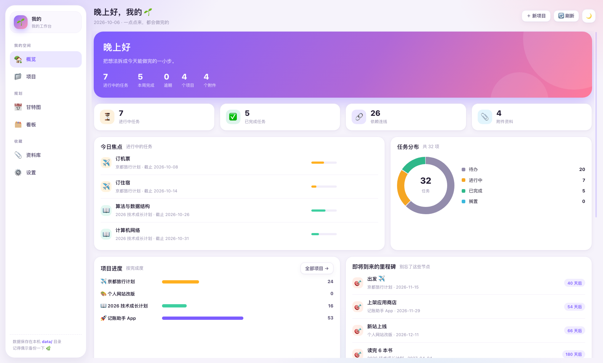
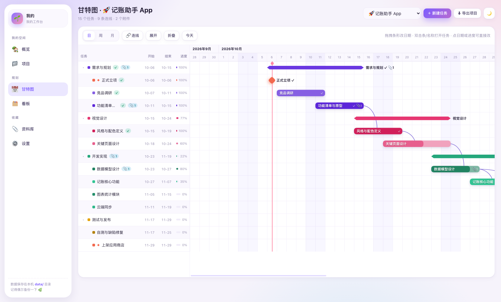
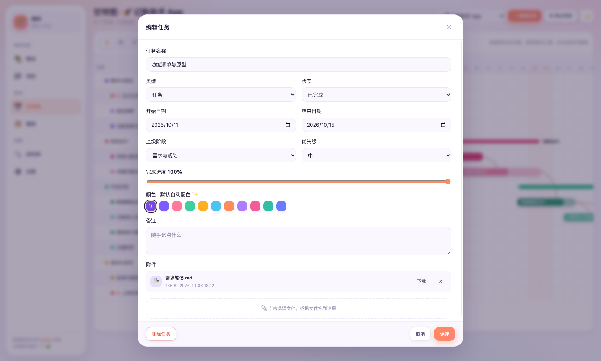
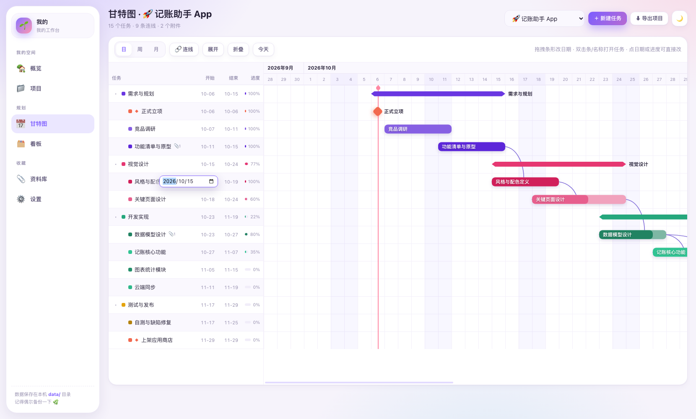
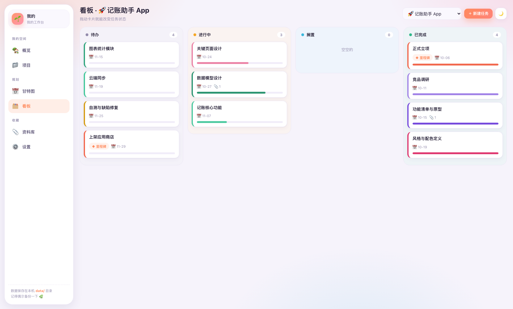
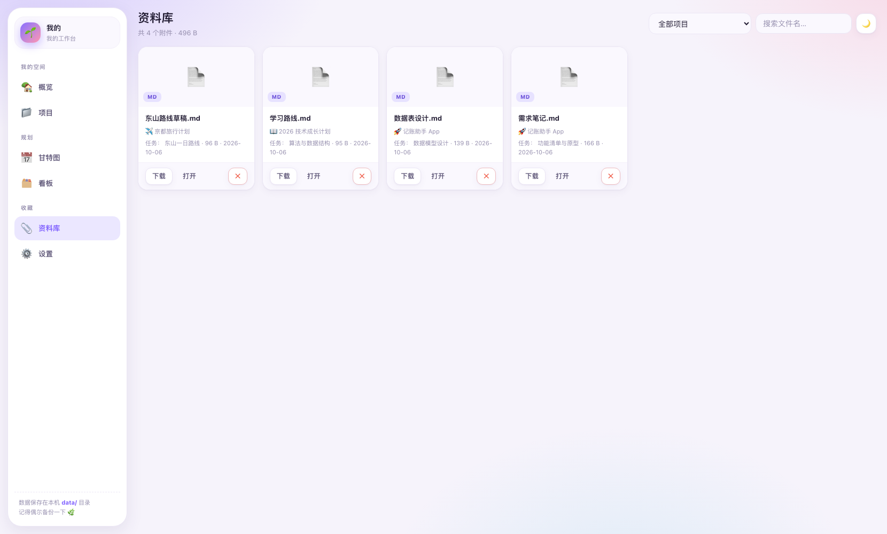
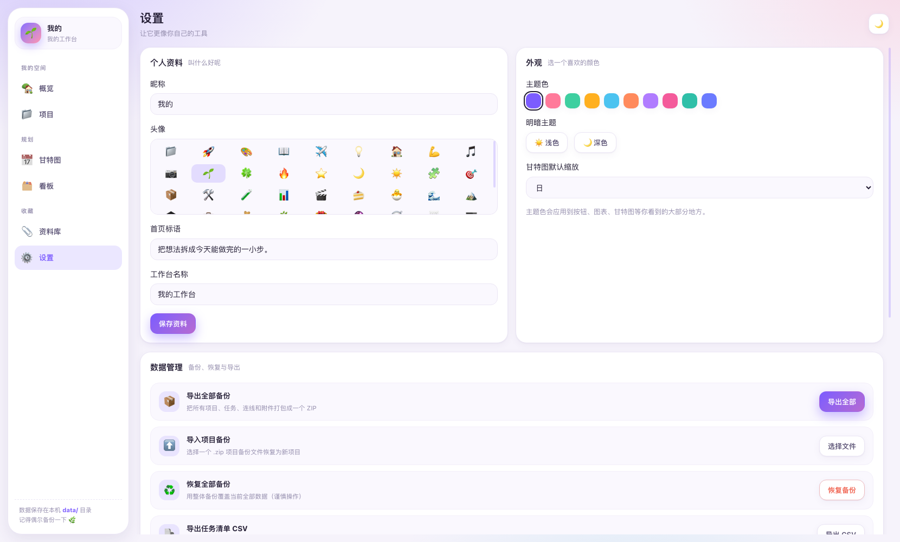

# 我的工作台

一个**只给自己用**的项目工作台：不需要登录、没有团队和权限那一套，打开就能用。
采用 **Node.js + 内置 SQLite**，**零第三方依赖**（不用 npm install），数据与附件全部保存在你自己电脑上。

支持 **Windows 10+** 与 **macOS（Apple Silicon / Intel）**。

---

## 一、环境要求

| 项目 | 要求 |
| --- | --- |
| Node.js | **22.5 或更高版本**（推荐 24 LTS） |
| 操作系统 | Windows 10+；macOS 11+（M 系列或 Intel） |
| 浏览器 | Chrome / Edge / Safari 等现代浏览器 |
| 网络 | **完全不需要联网** |

> 检查版本：命令行执行 `node -v`。没有装的话去 <https://nodejs.org/> 下载 LTS 版本。

---

## 二、快速开始

**Windows**：双击 `start-windows.bat`

**macOS**：双击 `start-mac.command`
> 如果提示"未验证的开发者"，右键该文件 → 打开 → 仍要打开；或先执行 `chmod +x start-mac.command`。

**命令行**：
```bash
cd my-workbench
node server.js
```

浏览器会自动打开 <http://127.0.0.1:4180>。按 `Ctrl + C` 停止。

可选参数：`node server.js --no-open`（不自动开浏览器）、`PORT=8080 node server.js`（改端口，被占用会自动顺延）。

---

## 三、界面导览

| 页面 | 能做什么 |
| --- | --- |
| 🏡 **概览** | 问候语 + 可编辑的首页标语、今日焦点任务（可一键 +10% 或标记完成）、任务分布环形图、各项目进度、即将到来的里程碑、最近更新 |
| 📁 **项目** | 新建 / 编辑 / 删除项目；每个项目可选 emoji 图标与主题色；卡片显示进度环与任务/附件/连线统计；卡片右上角可直接导出该项目备份 |
| 📅 **甘特图** | 阶段 / 任务 / 里程碑三种类型，树形层级；**拖拽条形改日期、拖两端改工期**；**手动连线做依赖**；日/周/月缩放；今日红线 |
| 🗂 **看板** | 待办 / 进行中 / 搁置 / 已完成 四列，**拖动卡片即可改状态** |
| 📎 **资料库** | 所有附件集中浏览，按项目筛选、搜索，图片直接预览缩略图 |
| ⚙️ **设置** | 昵称、头像 emoji、首页标语、主题色（10 种）、明暗主题、数据备份与恢复 |

---

## 四、甘特图：手动连线

1. 点击工具栏的 **🔗 连线** 按钮进入连线模式（光标会变成十字）；
2. 先点 **起点任务**（会高亮闪烁）；
3. 再点 **终点任务**，一条平滑的依赖曲线就画好了，箭头指向终点；
4. 点 **🔗 连线** 退出连线模式；
5. 想删除某条线：**直接点那条曲线**，确认后删除。

### 快捷编辑

| 操作 | 效果 |
| --- | --- |
| **双击任务条 / 左侧任务名** | 打开任务详情（改时间、进度、颜色、附件） |
| **双击「开始」或「结束」单元格** | 就地修改日期，回车保存、Esc 取消 |
| **双击「进度」单元格** | 就地修改进度，回车保存 |
| **拖拽条形** | 平移日期（两端一起走） |
| **拖拽条形两端的小手柄** | 调整工期 |

**任务上的小标记**：左侧任务名后面、甘特条右端、看板卡片上都会显示小徽标 —— 
**绿色 ✓** 表示已完成，**青色 📎N** 表示有 N 个附件（阶段上显示的是含子任务的合计）。

**阶段与子任务的联动**：阶段的起止日期由它下面的子任务**自动汇总**（数据库里也是实时同步的），
拖动阶段的条形会**带着所有子任务一起移动**，改子任务的日期阶段也会跟着伸缩。
阶段自己的日期/进度单元格是只读的（因为它们是算出来的），双击会打开任务详情。

连线是曲线（贝塞尔）而不是直角折线，交叉时更容易看清走向；已经有连线的两条任务不能重复连接，也不能连到自己。

---

## 五、自动配色（默认）

新建任务时颜色默认是**自动**的，系统按层级自动分配一套好看的配色：

- 每个**顶层阶段**占用一个独立色系（紫 / 玫红 / 青绿 / 琥珀 / 天蓝 / 紫罗兰 / 粉 / 湖绿 / 靛蓝 / 橄榄）
- **同一阶段下的任务和子任务**使用**同色系的深浅变化**，一眼就能看出属于哪个阶段，彼此又不会混淆
- **里程碑**统一用珊瑚红高亮，在图表里最显眼
- 颜色只由「层级 + 顺序」决定，**每次打开都一样**，不会随机变来变去

想自己指定颜色：编辑任务 →「颜色」→ 点右侧任意色块即可（该任务变成手动模式）。
点最左边的 **✨ 自动** 图标就能切回自动配色。

---

## 六、附件

- 打开任意任务 → 「附件」区域 → **点击选择文件** 或 **把文件直接拖进来**（支持多选）
- 附件的下载、删除都在同一个地方
- 甘特图左侧任务名后面会显示 **📎 数量**，看板卡片上也有
- 单文件上限 300MB，保存在 `data/files/`

---

## 七、备份与恢复（重点）

**单个项目整体导出**（包含附件）：
- 项目卡片右上角 **⬇** ，或在项目编辑弹窗里点「⬇ 导出备份」
- 得到的 ZIP 结构：
  ```
  项目名-日期.zip
  ├── project.json      项目、任务、连线、附件索引
  ├── tasks.csv         任务清单（Excel 可直接打开）
  ├── README.txt        说明
  └── attachments/      全部附件原始文件
  ```

**导入项目备份**：设置 → 数据管理 → 导入项目备份，选择上面的 ZIP，会恢复成一个新项目（附件一并还原）。

**整体备份 / 恢复**：设置 → 数据管理 → 导出全部备份 / 恢复全部备份。

**手动备份**：直接复制整个 `data` 文件夹即可（建议先停止服务）。

---

## 八、目录结构

```
my-workbench/
├── server.js            后端服务（HTTP + SQLite，零依赖）
├── zip.js               自研 ZIP 读写（用于打包附件）
├── package.json
├── start-windows.bat    Windows 双击启动
├── start-mac.command    macOS 双击启动
├── README.md
├── docs/                界面截图
├── data/                首次运行自动创建
│   ├── workbench.db     SQLite 数据库
│   └── files/           附件原始文件
└── public/              前端
    ├── index.html
    ├── app.css
    └── js/
        ├── app.js       页面与业务逻辑
        ├── gantt.js     甘特图（曲线连线 / 手动连线）
        ├── charts.js    纯 SVG 图表
        ├── api.js       API 客户端
        └── util.js      工具函数
```

---

## 九、数据表

| 表 | 说明 |
| --- | --- |
| `projects` | 项目（emoji、主题色、状态、优先级、标签） |
| `tasks` | 任务（自关联树结构，类型 task / group / milestone） |
| `links` | 任务之间的依赖连线（source → target） |
| `attachments` | 附件索引（真实文件在 data/files/） |
| `settings` | 个人设置（昵称、头像、主题色、标语等） |

首次运行会生成 4 个示例项目（记账助手 App、技术成长计划、个人网站改版、京都旅行计划），含 27 个任务、26 条连线和 4 个示例附件，可以直接删掉重建。

---

## 十、常见问题

**Q：提示"当前 Node.js 不支持内置 SQLite"？**
A：Node 版本太低，升级到 22.5 以上（`node -v` 确认）。

**Q：端口被占用？**
A：会自动换到下一个可用端口，看控制台输出的地址即可；也可以用 `PORT` 环境变量指定。

**Q：数据在哪？换电脑怎么办？**
A：全部在 `data/` 里。拷贝整个 `my-workbench` 文件夹过去即可；或用整体备份 ZIP。

**Q：误删了项目能恢复吗？**
A：删除是永久的。建议养成习惯：重要项目改完点一下卡片上的 ⬇ 导出备份。

**Q：别人能看到我的数据吗？**
A：服务只监听本机 127.0.0.1，数据不联网、不上传。

---

## 十一、技术栈

- **后端**：Node.js 原生 `http` + 内置 `node:sqlite`；ZIP 打包用 `zlib` 手写实现
- **前端**：原生 ES Modules + 原生 CSS，零框架；图表与甘特图全部手写
- **依赖**：0 个 npm 包

---

## 十二、界面预览














